<p align="center">
  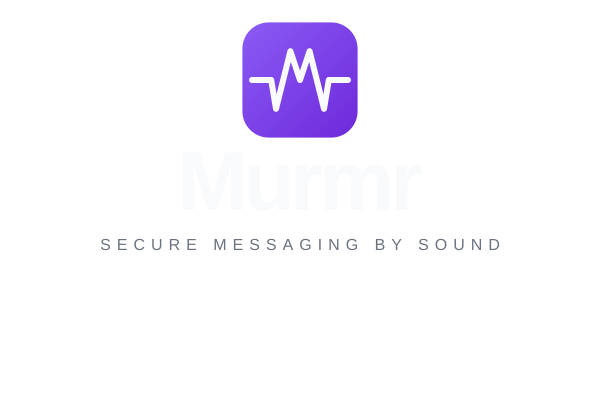
</p>

<h3 align="center">Zero-Trust End-to-End Encrypted Messaging via Acoustic Out-of-Band Key Exchange</h3>

<p align="center">
  A cross-platform, privacy-hardened messenger engineered with <b>Kotlin Multiplatform</b> and <b>Compose Multiplatform</b> (Android, Desktop JVM, iOS).<br>
  Eradicates Trust-On-First-Use (TOFU) by negotiating cryptographic keys directly over air using near-ultrasound acoustic sound waves (15–19 kHz), coupled with visual emoji SAS verification and AES-256-GCM message encryption.
</p>

<p align="center">
  <a href="LICENSE"></a>
  <a href="https://kotlinlang.org"></a>
  <a href="https://www.jetbrains.com/compose-multiplatform/"></a>
  <a href="#cryptographic-pipeline"></a>
  <a href="docs/protocol-acoustic.md"></a>
  <a href="#11-academic-attribution"></a>
</p>

<p align="center">
  <a href="#1-the-fundamental-problem">The Problem</a> ·
  <a href="#2-the-murmr-solution">The Solution</a> ·
  <a href="#3-core-innovations">Core Innovations</a> ·
  <a href="#4-user-experience--screenshots">Screenshots</a> ·
  <a href="#5-acoustic-pairing-protocol">Acoustic PHY/MAC</a> ·
  <a href="#6-cryptographic-pipeline">Cryptography</a> ·
  <a href="#7-system-architecture">Architecture</a> ·
  <a href="#8-comparative-analysis">Comparison</a> ·
  <a href="#9-getting-started--build">Build & Run</a> ·
  <a href="#10-testing-suite">Tests</a> ·
  <a href="#11-academic-attribution">Academic Attribution</a> ·
  <a href="#12-author--license">License</a>
</p>

---

<table align="center">
  <tr>
    <td align="center" width="33%"><h2>0% PII</h2>Zero phone numbers, zero emails, zero centralized directories. Identities are ephemeral local UUIDs.</td>
    <td align="center" width="33%"><h2>15 – 19 kHz</h2>Near-ultrasonic physical carrier for direct device-to-device Out-of-Band (OOB) key agreement.</td>
    <td align="center" width="33%"><h2>Zero-Trust</h2>Initial key exchange never touches any server, eliminating TOFU and Man-in-the-Middle (MITM).</td>
  </tr>
  <tr>
    <td align="center"><h2>5 Emojis SAS</h2>Visual Short Authentication String with 25 bits of entropy ($p_{\text{collision}} < 1 / 33{,}554{,}432$).</td>
    <td align="center"><h2>AES-256-GCM</h2>Authenticated encryption with directional ratcheting and granular cryptographic session expiry.</td>
    <td align="center"><h2>Multiplatform</h2>Single shared Kotlin codebase powering native Android, Desktop JVM (macOS/Win/Linux), and iOS.</td>
  </tr>
</table>

---

## 1. The Fundamental Problem: TOFU and the Centralized Key Dilemma

Virtually all modern end-to-end encrypted messaging platforms (such as Signal, WhatsApp, Telegram, or Wire) rely on an architectural compromise known as **Trust-On-First-Use (TOFU)**:

1. **Centralized Key Distribution**: Alice installs an app, generates a cryptographic keypair locally, and uploads her public identity key to a central server.
2. **Blind Key Fetching**: When Bob wants to send Alice a message, his client asks the central server for Alice's public key.
3. **The Single Point of Compromise**: If the central directory server is compromised, compelled by a court warrant, or operated by a malicious insider, the server can serve a fraudulent public key belonging to an attacker instead of Alice's genuine key.

```
[Standard Messaging Apps: Vulnerable TOFU Model]

  Alice                               Central Directory Server                           Bob
    |                                            |                                        |
    |---- (1) Upload Public Key A -------------->|                                        |
    |                                            |                                        |
    |                                  [ATTACKER COMPROMISE]                              |
    |                                  Server substitutes Key A                           |
    |                                  with Malicious Key M                               |
    |                                            |                                        |
    |                                            |<--- (2) Fetch Alice's Key -------------|
    |                                            |---- (3) Returns Fake Key M ----------->|
    |                                                                                     |
    |                    (4) Alice & Bob now unknowingly route                            |
    |                    encrypted traffic through the MITM Attacker!                     |
```

While applications attempt to mitigate this by displaying "Safety Numbers" or QR codes that users can cross-verify, **fewer than 1% of users actually verify Safety Numbers in real life**. Consequently, users place blind trust in the central key server.

---

## 2. The Murmr Solution: Physical Acoustic Out-of-Band Channel

Murmr decouples key agreement from the network entirely by establishing a **physical, near-ultrasonic acoustic channel (15–19 kHz)** directly between two mobile devices located in the same physical space (~10 to 50 cm apart).

```
[Murmr: Physical Acoustic Out-of-Band Key Agreement]

  Alice's Device                             Physical Air                              Bob's Device
  (sk_A, pk_A)                             (15 - 19 kHz Sound)                         (sk_B, pk_B)
       |                                            |                                       |
       |===== Slotted ALOHA Beacon Chirp ===========>                                       |
       |                                            |<==== Role ACK Beacon Chirp ===========|
       |                                            |                                       |
       |===== Acoustic Frame: [pk_A + nonce] ======>|                                       |
       |<==== Acoustic Frame: [pk_B + nonce] =======|                                       |
       |                                            |                                       |
 [Computes ECDH Shared Secret]                                            [Computes ECDH Shared Secret]
       |                                                                                    |
       +------------------- Derive 5 Visual SAS Emojis -------------------------------------+
       |                                                                                    |
  [Displays: 🦊 🐻 🐼 🐨 🦁]                                              [Selects: 🦊 🐻 🐼 🐨 🦁]
       |                                                                                    |
       +============================= SESSION ESTABLISHED ==================================+
```

### Why Sound?
- **Remote Attackers are Physically Excluded**: A network attacker on the internet cannot intercept, alter, or inject sound waves inside a private room without physical proximity.
- **Superior to QR Codes**: QR codes require line of sight, adequate ambient lighting, clean camera lenses, and steady hands. They fail completely in dark environments or if devices are placed side-by-side on a desk. Murmr works in total darkness, with phones in pockets or bags placed next to each other.
- **Superior to Bluetooth (BLE)**: BLE pairing leaks persistent hardware MAC addresses that enable physical tracking, triggers intrusive operating system permission dialogs, and introduces high discovery latencies. Murmr requires only standard microphone/speaker audio permissions.

---

## 3. Core Innovations

### 1. Zero Personally Identifiable Information (0% PII)
Murmr completely eliminates telephone numbers, email addresses, usernames, and address book scanning. Each device instantiates an anonymous cryptographic profile composed of an ephemeral **UUIDv4** and an **X25519 identity keypair** stored in hardware-backed secure storage.

### 2. Slotted ALOHA Half-Duplex Arbitration
Standard smartphone audio hardware is strictly half-duplex when transmitting ultrasound: speakers broadcasting at 15–19 kHz saturate the nearby microphone and create overwhelming acoustic feedback. Murmr implements a customized **Slotted ALOHA collision-avoidance protocol** with randomized slot timers and role-locking handshakes to coordinate bidirectional exchange cleanly.

### 3. Visual SAS Emoji Verification (Anti-Acoustic MITM)
To counter advanced local acoustic injection attacks (e.g., an adversary using directional ultrasonic parametric speakers in the room), Murmr derives a **Short Authentication String (SAS)** composed of **5 emojis** chosen from a curated 32-emoji dictionary ($2^5$ symbols), providing **25 bits of entropy**. The probability of an attacker manipulating the acoustic channel without altering the emojis is less than $1 \text{ in } 33{,}554{,}432$.

### 4. Directional Ratcheting & Granular Session Expiry
Message sessions derive unique symmetric keys per message via HMAC-SHA256 ratcheting. Past keys are permanently zeroed out from memory upon use (Forward Secrecy). Users can configure cryptographic session lifetimes (`30s`, `5m`, `1h`, `1d`, `7d`, `30d`, or custom). Upon expiration, keys are expunged from the secure vault, rendering all intercepted ciphertexts permanently unrecoverable.

### 5. Zero-Knowledge Asynchronous Relay Server
Messages travel over the internet inside blind, opaque envelopes routed through an asynchronous relay server built with **Kotlin Coroutines and Ktor**. The server operates as a stateless in-memory mailbox: it has no relational database, never touches cryptographic keys, cannot decrypt message bodies, and wipes envelopes immediately once drained by the recipient.

---

## 4. User Experience & Screenshots

<p align="center">
  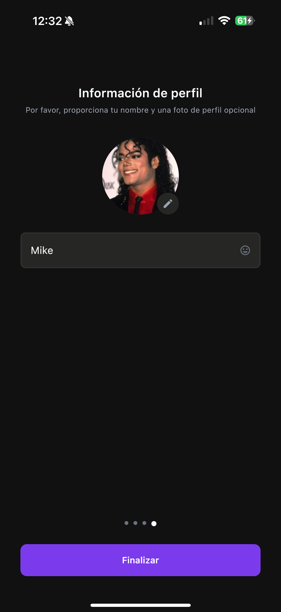
  &nbsp;
  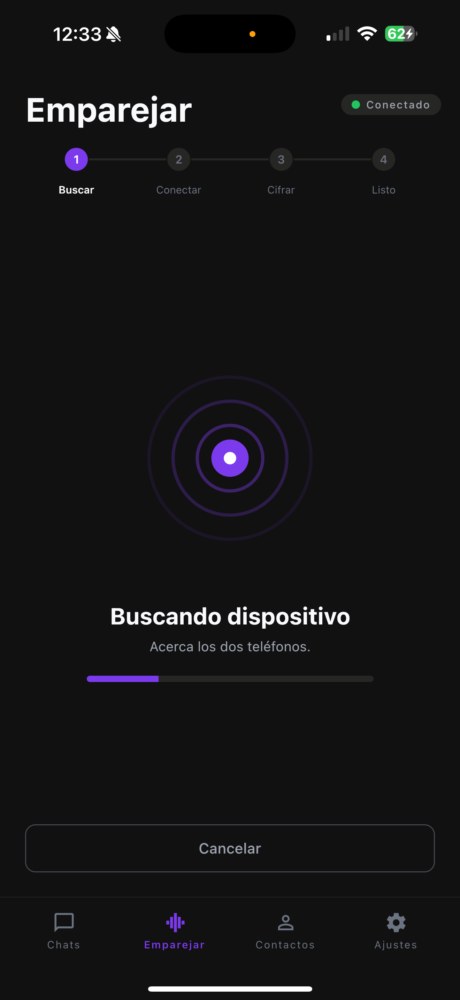
  &nbsp;
  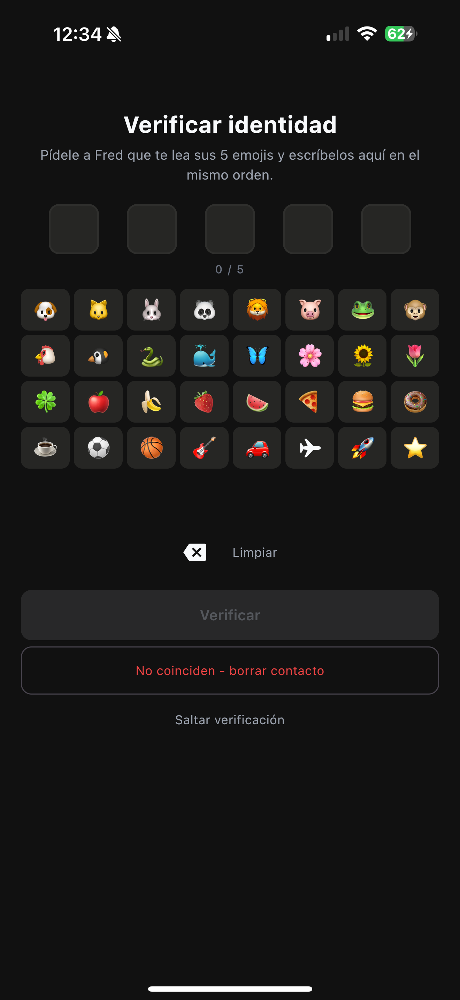
  &nbsp;
  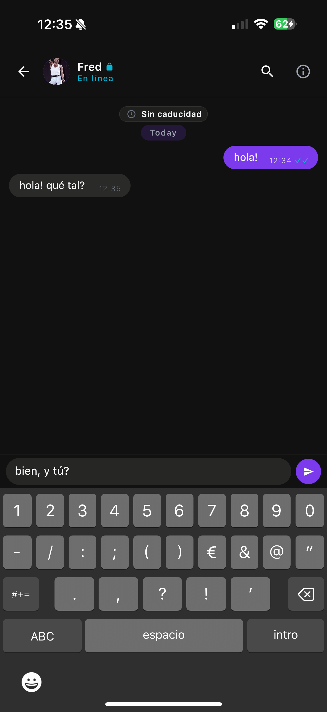
</p>

<p align="center">
  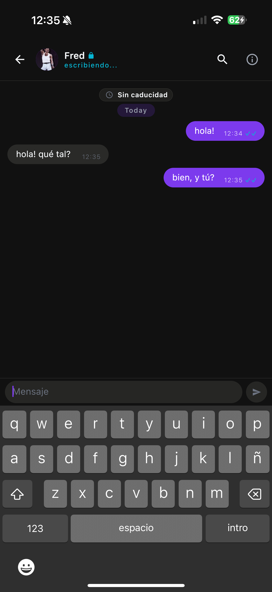
  &nbsp;
  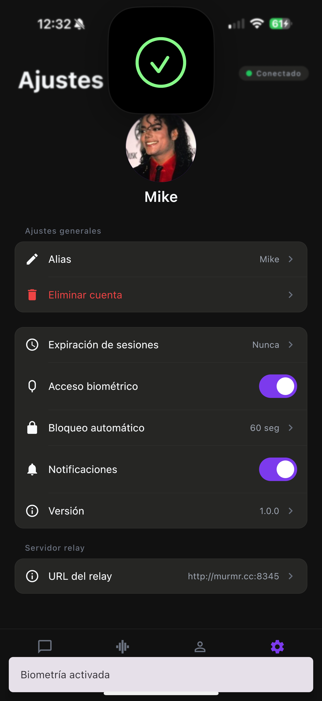
  &nbsp;
  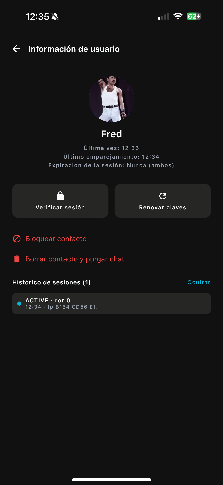
</p>

| Screen | Purpose & Technical Flow |
|---|---|
| **1. Anonymous Onboarding** | Zero personal data. Generates local X25519 identity keypair and UUID. Keys are saved to the platform's secure enclave (`AndroidKeyStore` / iOS `Keychain`). |
| **2. Acoustic Pairing** | Real-time FFT spectrogram visualizer. Devices emit and detect ultrasonic beacons, negotiating roles via Slotted ALOHA. |
| **3. 5-Emoji SAS Verification** | Asymmetric anti-MITM verification. Device A displays 5 derived emojis; Device B selects them from a randomized grid. |
| **4. E2EE Chat Screen** | High-performance Compose UI. AES-256-GCM message encryption with delivery states (`·` pending, `✓` sent, `✓✓` delivered/read). |
| **5. Session Expiry Chooser** | Configurable ephemeral expiration timers. When expired, keys and messages are securely overwritten. |
| **6. Settings & Security** | Auto-lock timers, biometric authentication triggers, audio device input/output selection, and database wiping tools. |
| **7. Contact Safety Detail** | Displays verified cryptographic fingerprint, key rotation indices, and effective session lifespan. |

---

## 5. Acoustic Pairing Protocol (PHY / MAC)

<p align="center">
  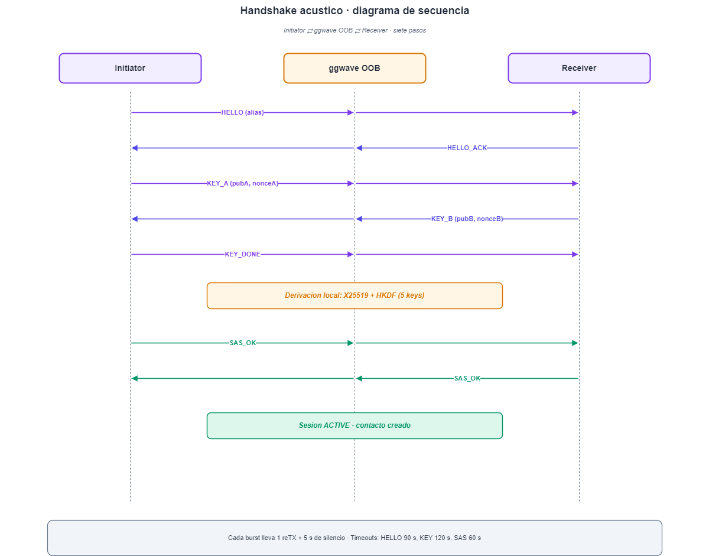
</p>

### Physical Layer (PHY)
- **Carrier Spectrum**: **15.0 kHz – 19.0 kHz**.
- **Human Audibility**: Inaudible or virtually imperceptible to adult human ears (presbycusis threshold typically begins around 14–15 kHz).
- **Sampling Rates**: Operates natively on standard hardware at 44.1 kHz or 48.0 kHz sampling rates ($f_{\text{Nyquist}} = 22.05 \text{ kHz} \text{ or } 24.0 \text{ kHz}$).
- **Modulation**: M-ary Frequency-Shift Keying (MFSK) / Chirp modulation with Barker sequence preambles for precise sample-level time synchronization.
- **Digital Filtering**: Digital bandpass filter isolates ultrasonic signals and eliminates environmental low-frequency voice, traffic, and room reverberation.

### Slotted ALOHA Media Access Control (MAC)
Because the acoustic channel is half-duplex on mobile hardware, simultaneous transmissions cause destructive interference and microphone deafening.

```
Slot Duration: T_slot = 120 ms + UniformRandom(0, 80 ms)

Device A State: [ LISTEN ] --------> [ DETECT BEACON ] --------> [ LOCK TRANSMITTER ]
Device B State: [ LISTEN ] --------> [ SEND BEACON   ] --------> [ LOCK RECEIVER    ]
```

1. **Discovery & Jitter**: When pairing starts, both devices enter a listening state while emitting brief discovery chirps at randomized time slots.
2. **Role Acquisition**: The first device to decode a clean beacon chirp from its peer assumes the **Transmitter** role; the other locks as the **Receiver**.
3. **Payload Exchange**: The Transmitter modulates its 32-byte X25519 public key and ephemeral session nonce.
4. **Deterministic Turnaround**: Upon completion, roles invert: the Transmitter closes its audio track and listens; the Receiver broadcasts its public key.
5. **Detailed Specification**: Complete packet formats, preamble math, and frame error correction are detailed in [docs/protocol-acoustic.md](docs/protocol-acoustic.md).

---

## 6. Cryptographic Pipeline

<p align="center">
  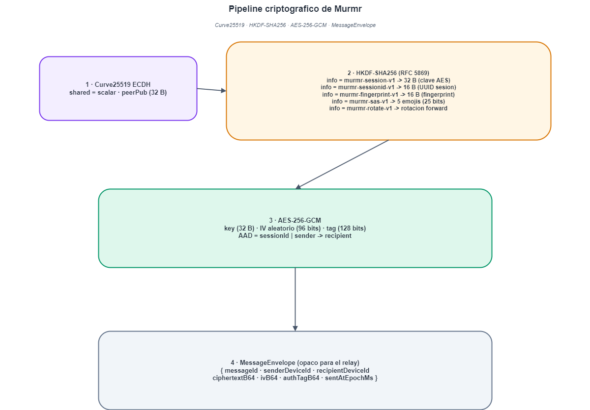
</p>

### 1. Key Agreement (ECDH X25519)
Both devices generate an ephemeral Curve25519 keypair:
$$sk \in_R \mathbb{Z}_q, \quad pk = sk \cdot G$$
Upon exchanging public keys over the acoustic channel, both parties calculate the identical shared secret:
$$SS = X25519(sk_A, pk_B) = X25519(sk_B, pk_A)$$

### 2. Key Derivation (HKDF-SHA256 - RFC 5869)
The shared secret $SS$ is extracted and expanded using domain-separated labels:
$$PRK = \text{HKDF-Extract}(\text{salt} = \text{nonce}_A \oplus \text{nonce}_B, SS)$$
$$\text{RootKey} = \text{HKDF-Expand}(PRK, \text{"murmr-session-v1"}, 32)$$
$$\text{SAS\_Entropy} = \text{HKDF-Expand}(PRK, \text{"murmr-sas-v1"}, 4)$$

### 3. SAS Emoji Generation
$$\text{SAS\_Index}_i = (\text{SAS\_Entropy} \gg (5 \times i)) \ \& \ 0\text{x}1\text{F} \quad \text{for } i \in \{0, 1, 2, 3, 4\}$$
Each 5-bit index ($0 \dots 31$) references a unique emoji from a fixed, phonetically and visually distinct alphabet:
$$\mathcal{A} = \{\text{🦊, 🐻, 🐼, 🐨, 🦁, 🐯, 🐵, 🦄, 🐲, 🐙, 🦋, 🐢, 🦉, 🦅, 🐬, 🦈, 🌸, 🍀, 🍄, 🚀, 🛸, ⚡, ⭐, 💎, 🎸, 🔔, 🍕, 🍔, 🎈, 🔑, 🛡️, 🧭}\}$$

### 4. Message Payload Encryption (AES-256-GCM)
Messages transmitted over the network are encrypted with AES-256 in Galois/Counter Mode (GCM) using a unique 96-bit IV:
$$\text{Ciphertext}, \text{Tag} = \text{AES-256-GCM}_{\text{Key}}(IV, \text{Plaintext}, \text{AssociatedData} = \text{Headers})$$
The 128-bit authentication tag ensures cryptographic integrity and ciphertext authenticity; any tampering in transit causes immediate rejection.

### 5. Forward Secrecy & Key Ratcheting
Directional symmetric key ratchets advance the state on every message:
$$K_{n+1} = \text{HMAC-SHA256}(K_n, \text{"murmr-ratchet"})$$
Used keys are immediately scrubbed from memory using secure wiping routines. See [docs/cryptography.md](docs/cryptography.md).

---

## 7. System Architecture

<p align="center">
  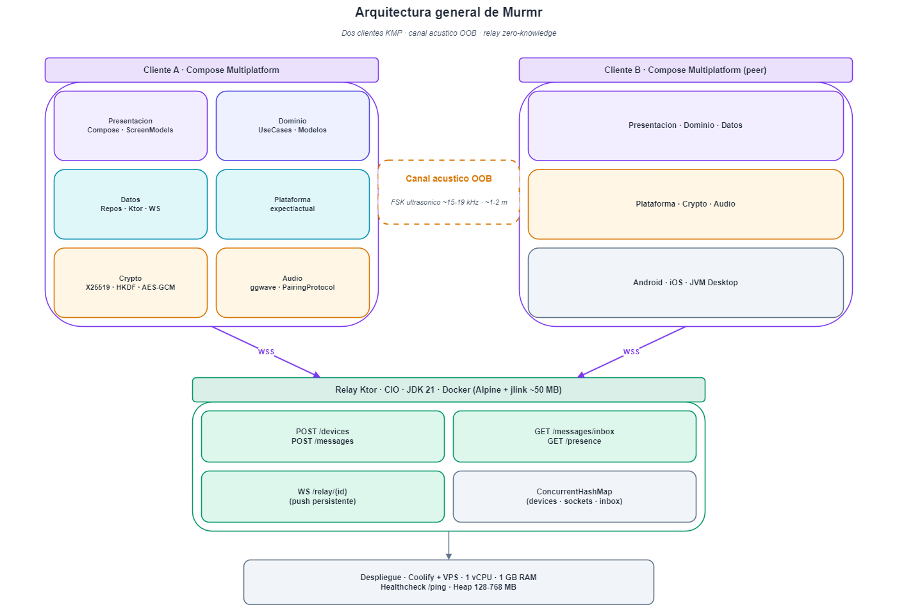
</p>

Murmr is engineered around **Clean Architecture**, **Model-View-Intent (MVI)** reactive state flow, and **Kotlin Multiplatform (KMP)**:

```
composeApp/src/
├── commonMain/              # 100% Shared Business Logic & UI
│   ├── kotlin/uoc/edu/psirvent/murmr/
│   │   ├── audio/           # DSP demodulator, Hann-window FFT, slotted ALOHA state machine
│   │   ├── crypto/          # Curve25519 ECDH, HKDF-SHA256, AES-256-GCM, SAS emoji generator
│   │   ├── data/            # SQLDelight database drivers, repository implementations, Ktor client
│   │   ├── domain/          # Pure entities (Contact, Message, Session), UseCases, State models
│   │   ├── presentation/    # Jetpack Compose UI screens, MVI ViewModels, theme design system
│   │   └── security/        # Memory scrubbing, app auto-lock, input sanitization
│   └── sqldelight/          # SQLDelight SQLite database schema (.sq definitions)
│
├── androidMain/             # Android Target
│   ├── kotlin/              # AudioRecord/AudioTrack, AndroidKeyStore (Hardware TEE/StrongBox)
│   └── res/                 # Vector adaptive icons, AndroidManifest, platform resources
│
├── jvmMain/                 # Desktop JVM Target (macOS / Windows / Linux)
│   └── kotlin/              # Java Sound API (TargetDataLine/SourceDataLine), Desktop SQLite
│
└── iosMain/                 # iOS Target
    └── kotlin/              # AVFoundation audio engine, Apple Keychain Services wrapper
```

---

## 8. Comparative Analysis

| Security & Architectural Feature | Signal | WhatsApp | Telegram | Session | **Murmr** |
|---|:---:|:---:|:---:|:---:|:---:|
| **Initial Key Exchange** | Central Server (TOFU) | Central Server (TOFU) | Central Server (MTProto) | Onion Network | **Acoustic Out-of-Band (OOB)** |
| **Reliance on Central Directory** | Yes | Yes | Yes | No (Lokinet) | **Zero (Server never sees keys)** |
| **Identity Requirement** | Phone Number | Phone Number | Phone Number | None | **Zero PII (Local Random UUID)** |
| **Physical Anti-MITM Verification** | Manual QR / Safety No. | Manual QR / Safety No. | Manual Emoji Hash | Blind TOFU | **Mandatory 5-Emoji Visual SAS** |
| **Relay Server Persistence** | Ephemeral | Ephemeral | Permanent Cloud | Swarm Storage | **Zero-Disk In-Memory Mailbox** |
| **Acoustic Spectrogram Visualizer** | No | No | No | No | **Yes (Real-time FFT)** |
| **Client UI Framework** | Native / Electron | Native / Catalyst | Native C++ / Qt | React Native / Electron | **Compose Multiplatform (Kotlin)** |

---

## 9. Getting Started & Build

### Prerequisites
- **JDK 21 LTS** (Eclipse Temurin recommended). *Note: Java 25+ is incompatible with netty/ktor.*
- **Android SDK** (API Level 34+, Android NDK r26).
- **macOS & Xcode 15+** (*only required for compiling iOS*).

### 1. Launch Desktop Client (JVM)
You can compile and run Murmr immediately on Windows, macOS, or Linux:
```sh
./gradlew :composeApp:run
```
*(User data and local SQLite databases are created under `~/.murmr/`).*

### 2. Build Android Application
```sh
# Compile debug APK
./gradlew :composeApp:assembleDebug

# Compile release APK
./gradlew :composeApp:assembleRelease

# Install directly on connected Android device via ADB
./gradlew :composeApp:installDebug
```
Output APK location:
`composeApp/build/outputs/apk/debug/composeApp-debug.apk`

### 3. Build iOS Application (macOS)
```sh
# Generate iOS multiplatform framework
./gradlew :composeApp:embedAndSignAppleFrameworkForXcode

# Open Xcode project
open iosApp/Murmr.xcodeproj
```

For complete setup instructions, troubleshooting, and SDK variables, see [docs/install.md](docs/install.md).

---

## 10. Testing Suite

The repository contains an extensive automated test suite covering cryptographic primitives, DSP audio demodulation, repository caching, and UI state models:

```sh
# Run all shared common and JVM unit tests
./gradlew test

# Run Android-specific unit tests
./gradlew :composeApp:testDebugUnitTest
```

### Key Automated Tests
- `X25519KeyExchangeTest`: Validates ECDH scalar multiplication and public key generation against RFC 7748 test vectors.
- `AesGcmTest`: Validates 256-bit encryption, 128-bit authentication tag verification, and tampering detection.
- `SasGeneratorTest`: Validates deterministic 5-emoji derivations and entropy distribution across all 32 alphabet symbols.
- `PairingProtocolTest`: Simulates Slotted ALOHA role negotiation, frame collisions, and half-duplex turnarounds.
- `ForwardSecrecyTest`: Validates HMAC-SHA256 ratcheting progression and ensures retired keys cannot decrypt future blocks.

---

## 11. Academic Attribution

**Murmr** was researched, engineered, evaluated, and defended as a **Final Degree Project (B.S. Thesis)** in **Computer Engineering** at the **Universitat Oberta de Catalunya (UOC)**.

- **Author**: Pablo Sirvent Jiménez
- **Academic Institution**: Universitat Oberta de Catalunya (UOC)
- **Degree**: Bachelor of Science in Computer Engineering
- **Year**: 2026

If you cite or use Murmr in academic publications, please refer to [CITATION.cff](CITATION.cff) or cite as:

```bibtex
@software{sirvent2026murmr_app,
  author = {Sirvent Jiménez, Pablo},
  title = {Murmr: Zero-Trust End-to-End Encrypted Messaging via Acoustic Out-of-Band Key Exchange},
  institution = {Universitat Oberta de Catalunya (UOC)},
  year = {2026},
  url = {https://github.com/sirventai/murmr-app}
}
```

---

## 12. Author & License

- **Author**: Pablo Sirvent Jiménez
- **Email**: `pablo@purebyte.ai`
- **GitHub**: [@sirventai](https://github.com/sirventai)

Murmr is open-source software licensed under the **[MIT License](LICENSE)**.
Copyright (c) 2026 Pablo Sirvent.
